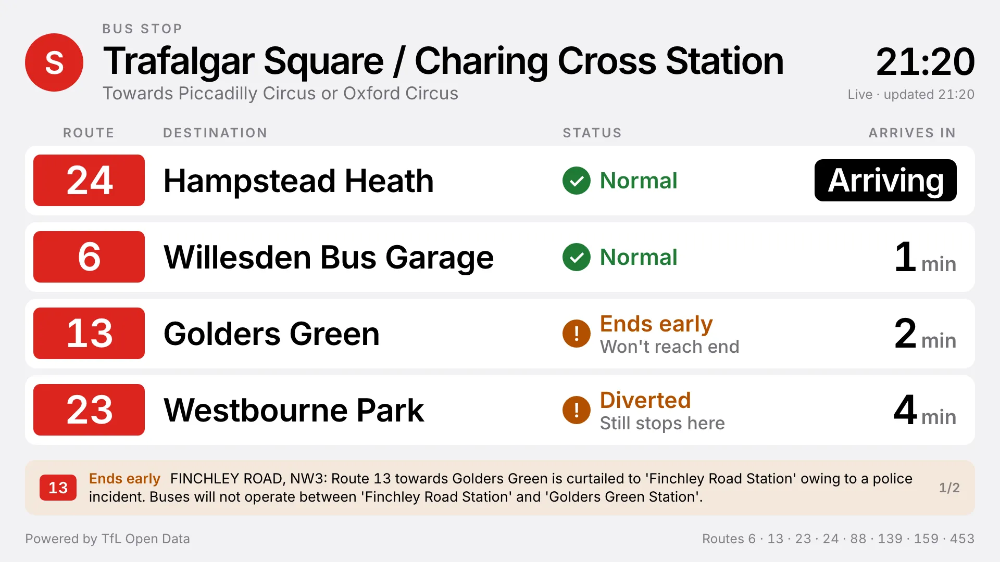

[](https://github.com/Screenly/tfl-bus-status-app/releases/latest)

# TfL Bus Status



Live bus arrivals for one London bus stop, with the current status of every
route that calls there. Data from the
[TfL Unified API](https://api-portal.tfl.gov.uk/).

## What it shows

Laid out to be read from the stop, a few metres away.

- **Every bus on its way, soonest first**, the way the countdown signs at
  London bus stops list them, under labelled columns: Route, Destination,
  Status, Arrives in. A route with two buses coming is listed twice. Under a
  minute away shows a solid "Arriving" pill.
- **A short status on every bus**, as a mark and a word so it doesn't rely on
  colour, with what it means underneath:

  | Status         | Underneath       | Meaning                                  |
  | -------------- | ---------------- | ---------------------------------------- |
  | ✓ Normal       |                  | Nothing reported on this route           |
  | ! Diverted     | Still stops here | Takes another road somewhere, calls here |
  | ! Skips stops  | Still stops here | Misses other stops, calls here           |
  | ! Ends early   | Won't reach end  | Cut short before its destination         |
  | ! Not stopping | Use another stop | TfL names this stop as missed            |
  | ! Fewer buses  | Longer waits     | Reduced frequency                        |
  | ! Delays       | Allow extra time | TfL mentions delays                      |
  | ! Disrupted    | Details below    | Anything else; see the strip             |

  A bus only appears on the board because TfL predicts it at this stop, so a
  diverted bus on the board is still coming here. It says "Normal", not "On
  time", because TfL publishes no bus timetable to be on time against.

- **The full story**: a strip under the rows gives TfL's own explanation for
  each disrupted route on screen (where, what, which stops are missed),
  taking turns every 10 seconds when there are several.
- **The stop itself**: if TfL lists the stop as closed, a red banner says so
  across the top. Other notices for the stop get an amber banner.
- **The stop's name**, the letter on its flag in a red roundel, which way the
  buses are heading, and a clock in London time wherever the screen is.

Rows stay a fixed, readable size, and a quiet stop's rows sit at the top. A
busy stop shows as many buses as fit: 5 on a landscape 1080p screen (4 while
the details strip is up) and up to 10 in portrait. A destination too long for
its row shrinks to fit, then scrolls.

### How bus status works

TfL gives every bus disruption the same status, "Special Service", so the
board reads the notice text instead (`src/notices.ts`), checking from the most
specific case to the least: Not stopping, Ends early, Not running, Diverted,
Skips stops, Delays, Fewer buses, then Disrupted for anything else.

Only notices TfL marks as in effect now (`isNow`) are shown. Most are
published weeks ahead of the works, and on any given day about a third of
routes carry one. A one-way notice ("towards Putney") only marks rows whose
destination it mentions, so the other direction stays "Normal".

TfL doesn't publish delays for buses. Arrivals are live predictions with no
timetable to compare against, so the board never claims a bus is late.

## Settings

| Setting         | What it does                                     | Default       |
| --------------- | ------------------------------------------------ | ------------- |
| `stop_id`       | The NaPTAN ID of the stop, such as `490005186S1` | `490005186S1` |
| `tfl_api_token` | Your TfL API key (global)                        | —             |
| `theme`         | `light` or `dark`                                | `light`       |
| `sentry_dsn`    | Optional Sentry DSN for error reporting (global) | —             |

Find a stop ID with the
[bus stop lookup](https://playground.srly.io/edge-apps/helpers/tfl/bus-stop-lookup/).
Get an API key from the [TfL API portal](https://api-portal.tfl.gov.uk/).

## How it keeps up

- Arrivals are fetched every 30 seconds, which is about how often TfL updates
  them. Between fetches the countdown keeps running from TfL's own
  seconds-to-arrival, so a screen whose clock is wrong still counts down
  correctly.
- Route statuses and stop notices are fetched every 5 minutes, and route
  statuses again whenever a new route turns up.
- If a fetch fails, the board keeps showing the last arrivals it had, marked
  "Offline", and drops buses as they pass. A screen that has never had
  arrivals says what went wrong.

## Getting started

```bash
bun install
bun run dev
```

`bun run dev` first writes `mock-data.yml` (gitignored) for the default stop.
The dev server calls the real TfL API, so put your key in `tfl_api_token` there.
To start over with a fresh file, run `bun run generate-mock-data --force`.

## Tests and checks

```bash
bun run test        # unit tests for the arrival and status logic
bun run lint
bun run type-check
bun run format:check
```

## Layout test

`e2e/layout.spec.ts` loads the app in a real browser against deliberately
awkward TfL data and measures every element on all 10 supported screen sizes.
It covers every status, 4-character routes, very long stop names and
destinations, a closed stop with the details strip, and the empty and error
messages. It fails if anything overlaps, spills out of its box or off screen,
or is cut off. Text too long for its box is allowed only when it scrolls.

It runs as part of `bun run screenshots`. To also save a picture of each case:

```bash
LAYOUT_SHOTS=/some/folder bun run screenshots
```

## Screenshots

```bash
bun run screenshots
```

This runs Playwright against TfL responses mocked in `e2e/tfl-mock.ts`, so the
images in `screenshots/` come out the same every run. The first run may need
`bunx playwright install chromium`.

## Build and deploy

```bash
bun run build
bun run deploy
```

In CI, `Update Edge App` installs the dependencies, builds the app and deploys
`dist/`.

## Releasing

Pushes to `main` start a stage deploy, which waits for approval. To release to production, tag a commit on `main` and push the tag (the workflow refuses tags not on `main`); the production deploy also waits for approval:

```bash
git checkout main && git pull
git tag v26.10.0
git push origin v26.10.0
```

Then publish a GitHub Release whose notes list the pull requests merged since the previous release. Add `--draft` to review the notes before publishing:

```bash
gh release create v26.10.0 --verify-tag --generate-notes --title v26.10.0
```
